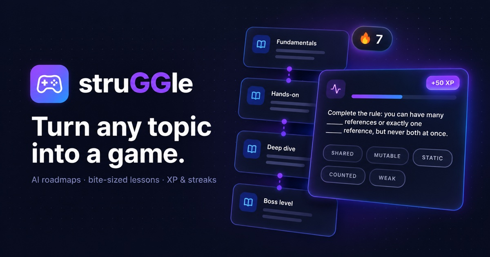
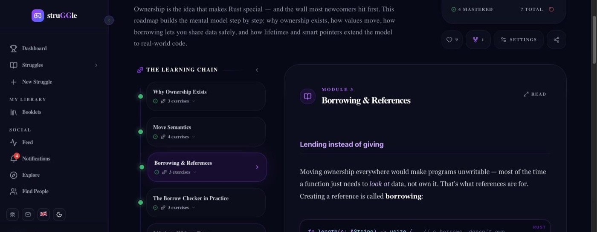
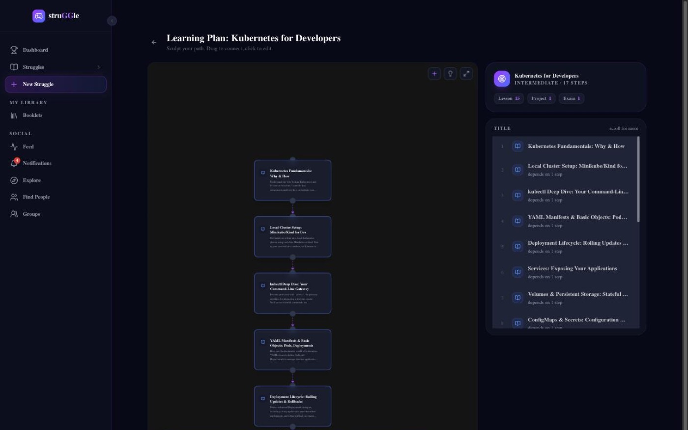
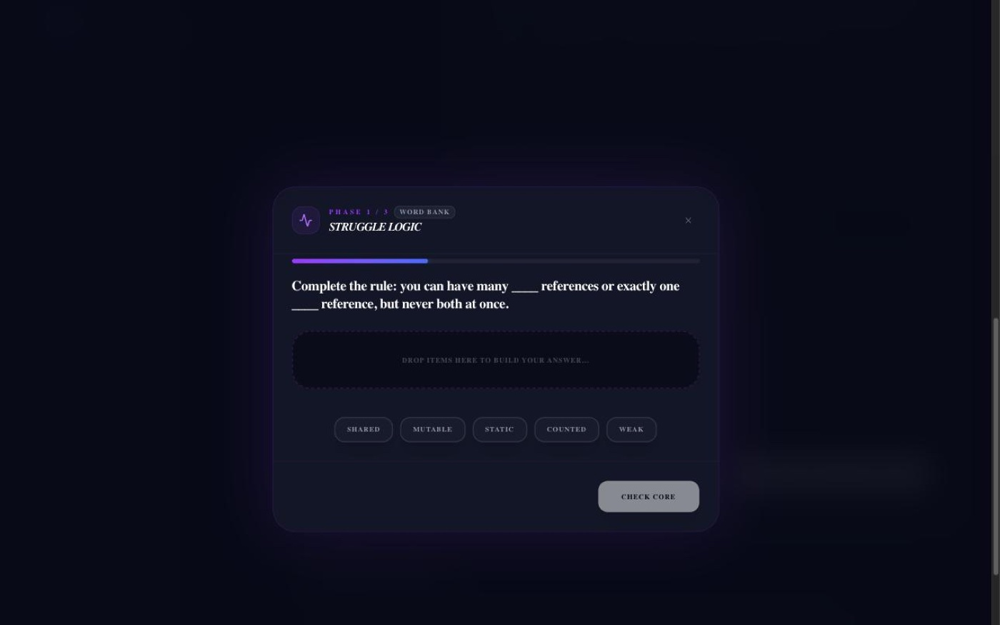
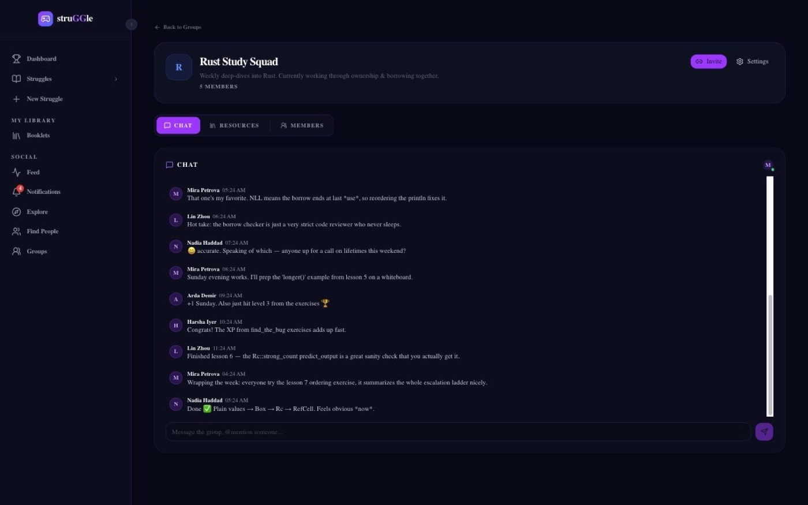
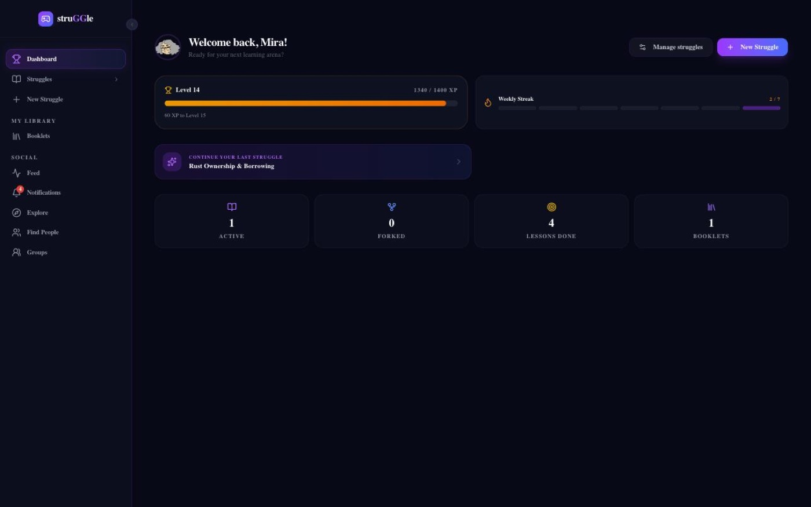
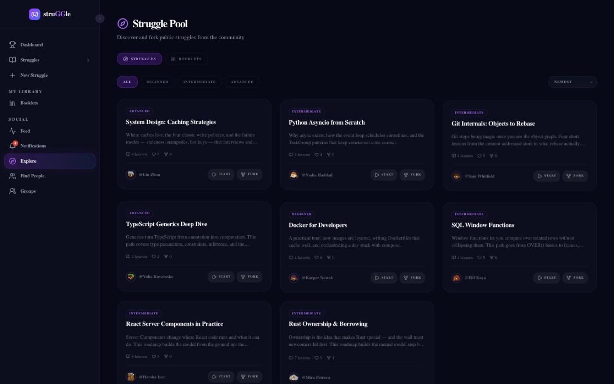

# struGGle.live

### Transform your learning *struggle* into a **Good Game**

Give the AI any topic. It plans your personal roadmap, writes bite-sized lessons and turns them into a game, with XP, streaks and exercises included.

---

<table>
<tr>
<td width="38%" align="center"></td>
<td width="62%">

### Any topic. Seriously.

From Rust ownership to Renaissance history: if you can name it, the AI can teach it.

> Rust Ownership · World War II · Linear Algebra · French Verbs · SQL Joins · Music Theory · Python Asyncio · Roman History · System Design · Color Theory …

| | |
|---|---|
| ⚡ **&lt;1 min** | to your first lesson |
| 🎯 **8** | ways to practice |
| 🌍 **4** | languages |
| 💳 **Free** | to start, no card needed |

</td>
</tr>
</table>

## 🗺️ From topic to mastery in three steps

| 1. Pick a topic | 2. AI plans your path | 3. Learn by playing |
|---|---|---|
| Type anything. Choose your difficulty and an AI tutor persona. | See your whole learning path before a single lesson gets written. Drag, reorder or edit any step on the visual roadmap. | Approve the plan and full lessons stream in live. Read, solve exercises, earn XP and keep your streak alive. |

## ✨ Features

<table>
<tr>
<td width="50%" valign="top">

### 🧠 Watch your roadmap being planned
- Edit the whole plan as a **node graph** before any lesson is written
- Lessons **stream in live**, one by one
- **AI tutor personas** with their own teaching style: senior engineer, professor, storyteller, philosopher and more
- Any topic, three difficulty levels, four languages

</td>
<td width="50%"></td>
</tr>
<tr>
<td width="50%"></td>
<td width="50%" valign="top">

### 🎮 Learning that plays like a game
- Interactive exercises: multiple choice, fill in the blanks, true/false, word bank, predict the output, **find the bug**
- The AI **grades free-text answers** and explains why
- **XP, levels and streaks** track your momentum

</td>
</tr>
<tr>
<td width="50%" valign="top">

### 👥 Struggle together, win together
- **Groups** with real-time chat and @mentions
- Share links with per-recipient permissions and expiry
- **Fork** public roadmaps and make them yours
- **Collections** that bundle roadmaps into learning paths

</td>
<td width="50%"></td>
</tr>
</table>

<table>
<tr>
<td width="50%">
Dashboard: XP, level and streak
</td>
<td width="50%">
Explore: community roadmaps
</td>
</tr>
</table>

## 🙋 However you learn, it fits

- **Solo & curious:** a roadmap built just for you, at your pace.
- **Study groups:** share a roadmap into your group chat and keep one streak for the whole crew.
- **Classrooms & teams:** teachers and team leads share a roadmap once; everyone works through it together.
- **Follow & fork:** see a friend crushing a new skill? Fork their roadmap and start the same struggle.

## 🛠️ Under the hood

  
  
  
  
  
  
  
  

- **Turborepo monorepo:** Next.js web app, NestJS API, admin dashboard, BDD and E2E suites
- **Five AI providers:** Claude, OpenAI, Gemini, DeepSeek or a local model through Ollama, switchable per user
- **Two-step generation:** plan first, then full content streamed over SSE
- **Self-hosted** with Docker behind NGINX

---

### Your next skill is one struggle away

No credit card. Just curiosity.

  

This repository is the public home of struGGle.live: screenshots, updates and feedback. The source code is private.

Found a bug or have an idea? <a href="../../issues">Open an issue</a>.

Built by <a href="https://github.com/bbuyukyuksel">Burak Büyükyüksel</a>.

